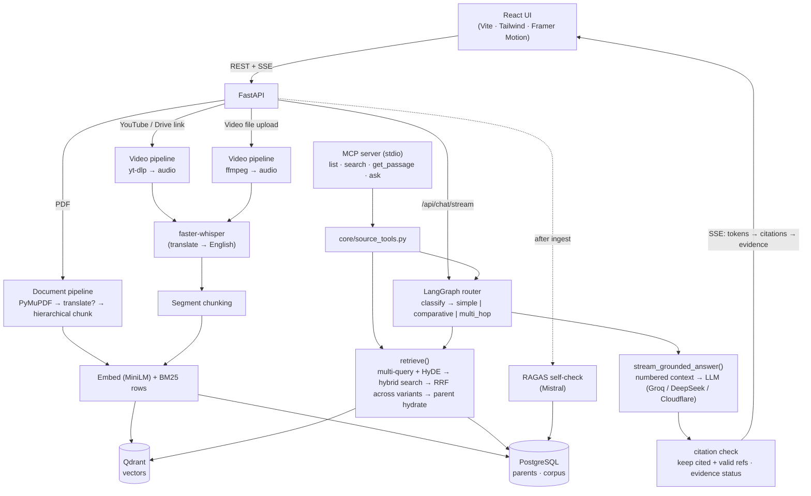

<div align="center">

# 🧠 SourceMind

**Chat with your documents and videos — in any language — with answers cited back to the exact page or timestamp.**

A multi-modal **RAG** platform: ingest PDFs or videos (YouTube, Google Drive, or a file upload — video is handled via transcription), then interrogate them in natural language over real-time streamed answers with page/segment citations.

> **SourceMind 2.0** (branch `sourcemind-2.0`) adds **validated citations** (only passages the answer actually cites are shown; invented citation numbers are dropped), an **insufficient-evidence answer** ("I could not find this in the provided sources"), retrieval and security fixes, a choice of **LLM provider** (Groq / DeepSeek / Cloudflare, never switched silently), an **MCP server**, 63 backend tests, and an evaluation harness. See [Current limitations](#current-limitations) for what is *not* done. The pre-2.0 code is tagged `v1-as-shipped`.

<br>


</div>

---

## Why this exists

Most RAG demos split a document into fixed chunks, embed them, retrieve the top-k by cosine similarity, and call it a day. That falls apart in practice: short chunks lose context, query phrasing rarely matches the source, exact keywords get missed by vector search, multiple sources bleed into each other, and complex questions need more than one retrieval step. **SourceMind is built to fix each of those failure modes** — and to *measure* whether it worked.

| Problem with naïve RAG | How SourceMind solves it |
|---|---|
| Short chunks lose context | Hierarchical parent/child chunking |
| Query ↔ document phrasing mismatch | Multi-query rephrasing + HyDE |
| Vector search misses exact keywords | Hybrid search (BM25 + dense) via Reciprocal Rank Fusion |
| Redundant retrieved chunks | MMR reranking for diversity |
| Cross-source contamination | Per-source metadata filtering in Qdrant |
| Complex / comparative questions | LangGraph query router (simple / comparative / multi-hop) |
| Citations that don't match the answer | Numbered passages; the server keeps only cited, valid passage numbers |
| Confident answers with no evidence | "Not found" answer + an `evidence` status (supported / insufficient / uncited) |
| "Is my retrieval any good?" | Evaluation harness with page-level gold labels ([`eval/`](eval/)); a RAGAS self-check per source |

---

## Features

**Ingestion**
- 📄 **PDFs** — drag & drop, up to 100 MB / 500+ pages (PyMuPDF, page numbers preserved)
- 🎬 **Videos, three ways** — paste a **YouTube** link, paste a public **Google Drive** link, or **drag & drop a video file** (mp4/mov/mkv/webm/avi/m4v)
- 🌍 **Any language → English** — non-English sources are translated at ingestion (Whisper's translate task for video, Groq for PDFs), so you always chat in English
- ⚡ **Non-blocking** — ingestion runs in FastAPI background tasks; CPU-heavy work (Whisper, embeddings, PDF parsing) is offloaded to threads so the API never freezes

**Retrieval & generation**
- **Hierarchical chunking** — small ~300-*character* children are embedded/searched; larger ~1500-character parents are what the LLM actually reads (token-aware sizing is a 2.0 fix)
- **Hybrid search** — dense (Qdrant cosine) + sparse (BM25, cached in memory per source) fused with **Reciprocal Rank Fusion**, then **MMR**-reranked for diversity
- **Multi-query + HyDE** — the query is auto-expanded with rephrasings and a hypothetical answer; the per-variant result lists are fused with RRF. If an expansion step fails (e.g. a rate limit) the UI shows "reduced retrieval" instead of silently answering with a weaker pipeline
- **Validated citations** — context passages are numbered `[1]…[n]` with their source title and page/segment; the answer cites them, and the server returns only the passages that were both shown and cited (invented numbers are reported, not displayed)
- **Insufficient evidence** — if nothing relevant is retrieved the app answers "I could not find this in the provided sources" without calling the LLM; if the model finds the passages don't answer the question it says so, and no citations are shown
- **Query router** — a compiled **LangGraph `StateGraph`** classifies each question and dispatches to `simple`, `comparative` (decompose → parallel retrieve → synthesize), or `multi_hop` (retrieve → reason → retrieve → synthesize)
- **Streaming** — tokens stream to the UI over Server-Sent Events in real time
- **Cross-document chat** — a global endpoint answers across your *entire* library at once

**Evaluation & UX**
- 📊 **RAGAS self-check** runs after each ingestion (faithfulness, answer relevancy, context recall, context precision), scored by Mistral to stay within free-tier limits. The questions are LLM-generated from the source's *opening chunks*, so treat these scores as a smoke test, not a benchmark
- ✨ **Editorial UI** — a warm, light "library" theme (React + Tailwind + Framer Motion) with Markdown-rendered answers and collapsible, numbered citations
- 🔌 **MCP server** — `list_sources`, `search_sources`, `get_passage`, `ask_sources` for Claude Desktop, MCP Inspector or any agent ([details](#mcp-server))
- 💸 **Free model stack by default** — Groq LLMs + local HuggingFace embeddings + local faster-whisper; DeepSeek or Cloudflare Workers AI selectable with one setting

---

## Tech stack

| Layer | Tools |
|---|---|
| Frontend | React 18 · Vite · TailwindCSS · Framer Motion · React Query · React Router · EventSource (SSE) · react-markdown |
| Backend | FastAPI (async) · asyncpg · Pydantic v2 |
| Vector DB | Qdrant (cosine, metadata-filtered) |
| Relational DB | PostgreSQL 16 (parent chunks · BM25 corpus · eval results · chat history) |
| Embeddings | sentence-transformers `all-MiniLM-L6-v2` — local, 384-dim, CPU |
| LLMs | Groq — `openai/gpt-oss-120b` (answers), `openai/gpt-oss-20b` (auxiliary); or DeepSeek `deepseek-flash`; or Cloudflare Workers AI |
| MCP | official Python MCP SDK (`mcp` 1.12, stdio transport) |
| Tests | pytest (fake LLM; real Postgres + Qdrant for isolation/MCP tests) · ruff · GitHub Actions |
| Evaluator LLM | Mistral `mistral-small-latest` (falls back to the Groq fast model) |
| Transcription | faster-whisper `small` — local, CTranslate2 int8 |
| Agent / RAG | LangChain + a compiled LangGraph `StateGraph` |
| Evaluation | RAGAS |
| Infra | Docker Compose |

---

## Architecture



**Request path for a chat query:** `GET /api/chat/stream` → LangGraph router → `retrieve()` → hybrid search → `stream_grounded_answer()`, streamed back as SSE. Retrieved child chunks are swapped for their full parent chunks before the model sees them, and every retrieval is filtered by `source_id` (omitted for global chat). After the last token, the server parses the `[n]` citations, drops numbers that don't point at a passage the model was shown, and sends only the cited passages plus an `evidence` status. All three strategies (simple, comparative, multi-hop) share this one answer path.

---

## Quick start (Docker)

**Prerequisites:** Docker + Docker Compose, a free [Groq API key](https://console.groq.com/keys), and optionally a free [Mistral API key](https://console.mistral.ai) (used as the RAGAS evaluator; falls back to Groq without it).

```bash
git clone https://github.com/Saicharan519/sourcemind.git
cd sourcemind
cp .env.example backend/.env      # then edit backend/.env and set GROQ_API_KEY
docker compose up --build
```

First boot downloads the embedder (~90 MB) and the Whisper model (~460 MB); later boots are fast thanks to persistent volumes.

- **App** → http://localhost:5173
- **API docs** → http://localhost:8000/docs
- **Qdrant dashboard** → http://localhost:6333/dashboard

---

## Local development (without Docker)

Run the two databases in Docker and the app on the host.

```bash
# 1. Databases
docker run -d --name sourcemind-postgres -e POSTGRES_USER=sourcemind \
  -e POSTGRES_PASSWORD=sourcemind_secret -e POSTGRES_DB=sourcemind \
  -p 5432:5432 postgres:16-alpine
docker run -d --name sourcemind-qdrant -p 6333:6333 qdrant/qdrant

# 2. Schema (once)
docker exec -i sourcemind-postgres psql -U sourcemind -d sourcemind < scripts/init_db.sql

# 3. Backend  (.env must live in backend/)
cd backend
python -m venv .venv && source .venv/bin/activate   # Windows: .venv\Scripts\activate
pip install -r requirements.txt
cp ../.env.example .env            # set GROQ_API_KEY (+ optional MISTRAL_API_KEY)
python -m uvicorn main:app --reload --port 8000

# 4. Frontend (new terminal)
cd frontend && npm install && npm run dev
```

> **Note:** `ffmpeg` must be on your PATH (required by Whisper, yt-dlp, and video-file ingestion).

---

## API reference

| Method | Path | Description |
|---|---|---|
| `POST` | `/api/ingest/document` | Upload a PDF (202, processed in background) |
| `POST` | `/api/ingest/video` | Ingest a YouTube **or public Google Drive** link |
| `POST` | `/api/ingest/video-file` | Upload a video file (mp4/mov/mkv/webm/avi/m4v) |
| `GET` | `/api/sources` | List all sources with eval scores |
| `GET` | `/api/sources/{id}` | Source detail + full RAGAS results |
| `DELETE` | `/api/sources/{id}` | Delete a source (cascades to Qdrant + Postgres) |
| `GET` | `/api/chat/stream` | **SSE** per-source streaming chat |
| `GET` | `/api/chat/global/stream` | **SSE** cross-document chat |
| `POST` | `/api/evaluate/{id}` | Manually (re)run RAGAS evaluation |
| `GET` | `/api/evaluate/{id}` | Fetch latest RAGAS results |

**SSE event stream:**
```
data: {"type": "query_type",  "value": "comparative"}
data: {"type": "sub_queries", "value": ["...", "..."]}           // comparative / multi-hop only
data: {"type": "warning",     "value": {"degraded": ["hyde"]}}  // only if an expansion step failed
data: {"type": "context",     "value": [{"ref": 1, ...}, ...]}   // every passage the model was shown
data: {"type": "token",       "value": "The limit is 30 days [2]."}
data: {"type": "citations",   "value": [{"ref": 2, "type": "document", "page_number": 4, "excerpt": "..."}]}
data: {"type": "evidence",    "value": {"status": "supported", "invalid_refs": [], "n_context": 6}}
data: {"type": "done",        "value": null}
```
`citations` holds only passages the answer cited; `evidence.status` is `supported` (at least one valid citation), `insufficient` (the "not found" answer) or `uncited` (an answer with no valid citation, shown with a warning badge). `GET /health` reports the active LLM provider and models.

---

## Model routing (free-tier strategy)

Quality where it matters, speed everywhere else — this split is what keeps the whole thing on free tiers.

| Task | Model |
|---|---|
| Final answer + comparative synthesis | Groq **`openai/gpt-oss-120b`** |
| Classification · multi-query · HyDE · decomposition · multi-hop reasoning · titles · QA generation | Groq **`openai/gpt-oss-20b`** |
| RAGAS evaluator | **Mistral** `mistral-small-latest` (→ Groq fast-model fallback) |
| Embeddings | local `all-MiniLM-L6-v2` (CPU) |
| Transcription | local faster-whisper `small` (CPU, int8) |

### Choosing the LLM provider

Set `LLM_PROVIDER` in `backend/.env` and restart the backend. Exactly one provider is used; if its key is missing the app reports a clear configuration error, and there is **no automatic fallback**, so an answer never silently comes from a different model.

| `LLM_PROVIDER` | Models (main / fast) | Cost | Notes |
|---|---|---|---|
| `groq` (default) | `openai/gpt-oss-120b` / `openai/gpt-oss-20b` | free tier, 200K tokens/day per model | about 50 questions/day on the free tier |
| `deepseek` | `deepseek-flash` / `deepseek-flash` | ~$0.001 per question (measured) | thinking mode disabled; no daily cap |
| `cloudflare` | `@cf/openai/gpt-oss-120b` / `-20b` | free 10,000 Neurons/day | wired up and unit-tested, **not yet run live** |

**Measured on 5 benchmark questions** (factoid, exact ID, comparative, multi-hop, unanswerable; full pipeline, no cache; [`eval/results/v2_*_compare5`](eval/results/)): both providers answered the factoid, exact-ID and comparative questions correctly and refused the unanswerable one. DeepSeek used 19.4K input / 1.4K output tokens in total (about **$0.004**, off-peak price) with a 10.9 s median latency; Groq used 20.8K / 5.6K tokens (gpt-oss reasoning tokens count as output) with a 17.8 s median. On the multi-hop question neither had the second page in context: Groq refused and DeepSeek gave the half it could cite and said the rest was missing. Five questions is a smoke test, not a benchmark.

---

## Project structure

```
sourcemind/
├── backend/
│   ├── main.py               # FastAPI app + lifespan (marks interrupted ingest jobs failed)
│   ├── mcp_server.py         # MCP server (stdio)        mcp_demo_client.py  # stdio client demo
│   ├── api/routes/           # ingest · chat · global_chat · sources · evaluate
│   ├── core/
│   │   ├── document_pipeline.py   video_pipeline.py   chunker.py
│   │   ├── embedder.py            bm25_index.py       hybrid_search.py
│   │   ├── rag_engine.py          agent_router.py     evaluator.py
│   │   └── llm_providers.py       source_tools.py     # provider selection · MCP tool layer
│   ├── db/                   # postgres.py · qdrant.py
│   ├── utils/                # audio.py · streaming.py · url_safety.py
│   ├── tests/                # pytest: citations, retrieval, security, providers, isolation, MCP
│   └── requirements.txt
├── eval/                     # benchmark harness: corpus manifest, question pipeline, runner, scorer
├── docs/                     # roadmap · decisions · progress · evaluation method · demo script
├── frontend/src/             # pages · components · hooks · api client
├── scripts/init_db.sql
└── docker-compose.yml
```

---

## MCP server

`backend/mcp_server.py` exposes the library to MCP clients over stdio. It reuses the same retrieval code as the web app (`core/source_tools.py`).

| Tool | What it does | Uses the LLM? |
|---|---|---|
| `list_sources` | ids, titles, types and status of everything ingested | no |
| `search_sources(query, source_id?, top_k=6, expand_query=false)` | hybrid search; passages with page or timestamp | only if `expand_query` |
| `get_passage(source_id, page? \| at_seconds?)` | full text of a document page, or the video segment at a time | no |
| `ask_sources(question, source_id?)` | the full pipeline: cited answer, `evidence` status, or "not found" | yes |

Document text is returned under `untrusted_content`: it comes from uploaded files and the calling model should treat it as data, not instructions. Bad ids or empty queries return `{"error": "..."}`. The server is local and single-user: it can read every source in the configured database.

```bash
# from backend/, venv active, Postgres + Qdrant running
python mcp_demo_client.py "What is MLOps?"            # launches the server over stdio, calls all 4 tools
python mcp_demo_client.py "What is MLOps?" --no-ask   # skip the LLM call
npx @modelcontextprotocol/inspector python mcp_server.py   # browse the tools interactively
```

**Claude Desktop** (`claude_desktop_config.json`; use your own absolute paths):
```json
{
  "mcpServers": {
    "sourcemind": {
      "command": "C:/path/to/sourcemind/backend/.venv/Scripts/python.exe",
      "args": ["C:/path/to/sourcemind/backend/mcp_server.py"],
      "cwd": "C:/path/to/sourcemind/backend"
    }
  }
}
```
The stdio demo client run is verified; MCP Inspector and Claude Desktop use the same stdio launch but were not run as part of this release.

---

## Tests

```bash
cd backend && python -m pip install -r ../requirements-dev.txt
python -m pytest tests -q          # 63 tests
python -m ruff check . ../eval
```

- **Citations and abstention:** reference parsing (`[1]`, `[1, 3]`, `[2-4]`, gpt-oss's native `【6】`), invented references are dropped, only cited passages are emitted after the answer, a "not found" answer with no LLM call when nothing is retrieved, errors reported (not swallowed), all through the real LangGraph with a fake LLM.
- **Retrieval:** RRF fusion of query variants, failed expansions are reported, BM25 cache invalidation.
- **Security:** SSRF URL cases (e.g. `http://169.254.169.254/?x=youtube.com`), server-chosen upload names, PDF magic bytes, and API-level rejection.
- **Source isolation, MCP and data layer (real Postgres + Qdrant):** two tiny PDFs are ingested through the real pipeline into a throwaway database and collection. The tests check that searching one source never returns the other's chunks, cover each MCP tool, and run a real MCP client session. They skip automatically if Docker isn't running.

These are unit and integration tests with a fake LLM. Answer quality is measured separately by the [evaluation harness](eval/) ([method](docs/EVALUATION.md)).

---

## Demo

[docs/DEMO.md](docs/DEMO.md) has a 5-minute demo script with a public, redistributable demo corpus (NIST, arXiv CC-BY papers, an MIT OpenCourseWare lecture) and questions whose answers and pages have been checked.

---

## Current limitations

- **No full benchmark result yet.** The harness, corpus and a 43-question pilot set exist in [`eval/`](eval/), but the full as-shipped vs 2.0 comparison has not been run, so this README claims no accuracy numbers. The per-source RAGAS scores are a synthetic self-check, not a benchmark.
- **Single-user, local only.** There is no authentication; run it on your own machine, not on a public server. "Isolation" means per-source filtering, which is tested.
- **No corrective re-retrieval.** When the evidence is insufficient the app says so; it does not yet retry with a rewritten query.
- **No automatic provider fallback** (by design). If the provider hits its rate limit, the chat shows a clear error; switch `LLM_PROVIDER` to continue.
- **Chunk sizes are in characters**, not tokens.
- **Ingestion jobs run in-process.** A restart marks in-flight jobs as failed (re-upload them); there is no job queue.
- **Backend tests aren't in CI yet.** They need the full ML stack (torch) plus Postgres and Qdrant. CI runs lint, the eval unit tests, dataset validation and the frontend build.

## Roadmap

Done in 2.0: evaluation harness · retrieval fixes (variant fusion, cached BM25) · validated citations + insufficient-evidence answer · SSRF / upload hardening · provider selection · MCP server · backend tests.

Next: run the full benchmark (as-shipped vs 2.0) · cross-encoder reranker ablation · corrective re-retrieval · multi-user auth · backend tests in CI · a measured tool-calling agent compared against the fixed pipeline.

---

## Troubleshooting

- **`.env` not picked up** → it must live in `backend/`, not the repo root (config loads it relative to the backend's working directory).
- **`yt-dlp` "Requested format is not available"** → YouTube changed formats; run `pip install -U yt-dlp`.
- **Google Drive link fails** → the video must be shared as *"Anyone with the link."*
- **Model downloads look stuck** → first run pulls ~600 MB of models; subsequent runs use the cache/volumes.
- **Scanned PDF returns empty pages** → PyMuPDF can't read image-only PDFs; OCR them first (`ocrmypdf`).

---

## Project docs

[docs/](docs/) holds the 2.0 roadmap, the decision log, a progress log and the evaluation methodology.

## License

MIT — see [LICENSE](LICENSE).
